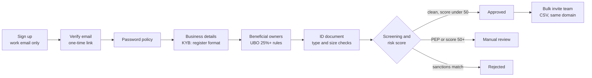

# KYC Onboarding Automation

[](https://github.com/youssefmohamedymsh/OnboardingAutomation/actions/workflows/ci.yml)


An end-to-end BDD test suite for a **business-banking KYC/KYB onboarding** flow: sign-up, email verification, company checks, beneficial owners, ID upload, sanctions and PEP screening, risk scoring, and bulk team invites.

It runs against **Ledgerline**, a small fictional onboarding app bundled in this repo, so anyone can clone it and run the whole suite with one command. Nothing external is needed.

**53 scenarios · 8 features · UI (Selenium) and API (Rest-Assured) · runs in CI on every push**

## The flow under test



## What's covered

| Feature | Rules checked | Tag |
|---|---|---|
| Sign-up | Work emails only; one application per email; a verification email is sent | `@signup` |
| Email verification | 5-rule password policy; matching confirmation; a link works only once | `@verification` |
| Business details (KYB) | Registration-number formats for GB, IE, DE and AE | `@kyb` |
| Beneficial owners (UBO) | Owners 18+; 25% to 100% each; 100% total cap; ISO country codes; full legal names | `@ubo` |
| ID document | PDF, PNG or JPG only; not empty; 5 MB limit | `@document` |
| Screening and decision | Sanctions → rejected; PEP → manual review; score ≥ 50 → manual review; the score from each risk factor; incomplete applications blocked | `@screening` |
| Team invites | CSV header; per-row validation (domain, format, duplicates); partial success reporting | `@team` |
| API rules | Status codes and error bodies; sessions; locked decided applications; invites gated on approval | `@api` |

### Risk scoring

The screening scenarios assert exact scores, so the model is spelled out here:

| Factor | Points |
|---|---|
| Country | GB, IE, DE: 10 · AE: 25 |
| Industry | Software: 0 · Retail, consulting: 5 · Money services: 35 · Crypto, gambling: 40 |
| Annual turnover | Under 1M: 0 · 1M to 10M: 5 · Over 10M: 10 |
| PEP owner | +30 |
| Driving licence as ID | +5 |

A sanctions match rejects the application whatever the score. The test watchlists are fictional names defined in [`Onboarding.java`](src/main/java/io/github/youssefmohamedymsh/ledgerline/Onboarding.java).

## How the suite is built

- **API-backed setup.** A scenario about the owners screen creates and verifies its applicant through the API in milliseconds, injects the session into the browser, and only drives the screen under test. Scenarios stay fast and independent, and a bug on one screen doesn't cascade into every scenario after it.
- **Stable locators.** Every element the tests touch has a `data-testid`, so styling and layout changes don't break tests. No XPath, no generated IDs.
- **Explicit waits only.** No `Thread.sleep` and no implicit waits. A shared `BasePage` waits for exactly what each step needs and retries on stale elements.
- **Generated test data.** Unique work emails per scenario, and upload files (valid scans, an empty PDF, a 6 MB file, a `.txt`) are generated at runtime, so there are no binaries in the repo.
- **Business-readable Gherkin.** Scenario Outlines and data tables keep each rule's examples in one place a compliance analyst could review.
- **Evidence on failure.** A screenshot is attached to the report for every failed UI scenario.
- **Self-contained target.** The app under test lives in `src/main`, the suite in `src/test`. Tests start the app on a free port, or point at a deployed one with `-DbaseUrl`.

## Running it

**Requirements:** Java 17+, Maven 3.9+, and Google Chrome for the UI scenarios.

```bash
mvn verify                                       # everything (UI in a visible browser)
mvn verify -Dheadless=true                       # everything, headless
mvn verify -Dcucumber.filter.tags="@api"         # API scenarios only, no browser needed
mvn verify -Dcucumber.filter.tags="@screening"   # one area
mvn test -Dcucumber.execution.dry-run=true       # check every step is wired up
```

Reports go to `target/cucumber-html-reports/overview-features.html` and `target/cucumber.html`.

Other options: `-DbaseUrl=http://host:port/` to test a running instance, `-Dchrome.binary=/path/to/chrome`, and `-Dchrome.args=--no-sandbox` for containers.

### Try the app yourself

```bash
mvn compile exec:java   # then open http://localhost:8080
```

Verification emails appear in the demo inbox at `/inbox.html?to=<your email>`.

## Project structure

```
src/main/                         the app under test (Ledgerline)
  java/.../ledgerline/
    Onboarding.java               business rules: validation, screening, risk scoring, invites
    LedgerlineServer.java         JDK HTTP server: JSON API and static pages
  resources/web/                  the onboarding screens (HTML and JS)
src/test/
  java/.../kyc/
    support/                      app startup, browser hooks, API client, test data and files
    pages/                        page objects
    steps/                        step definitions, one class per area
    runner/TestRunner.java
  resources/features/
    ui/                           7 UI features
    api/                          API feature
```
